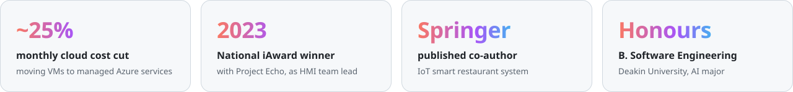
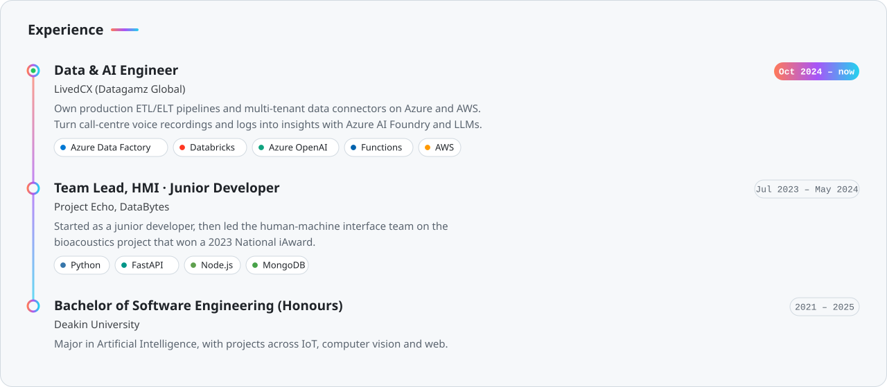
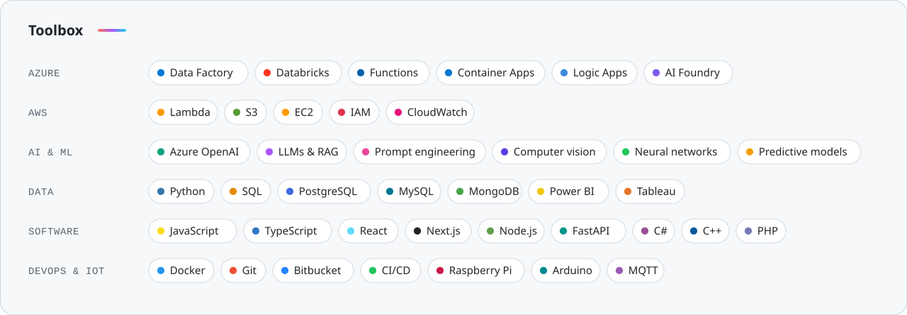
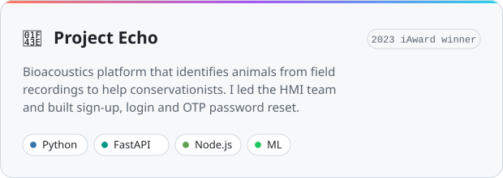
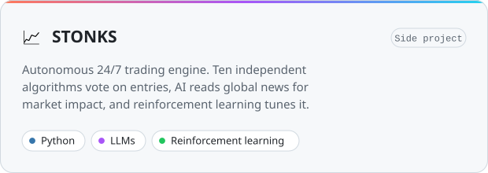
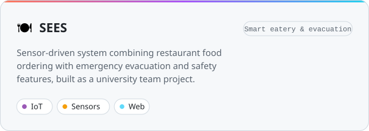
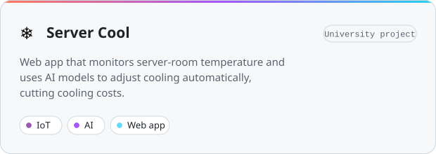
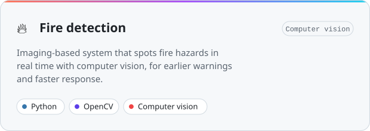
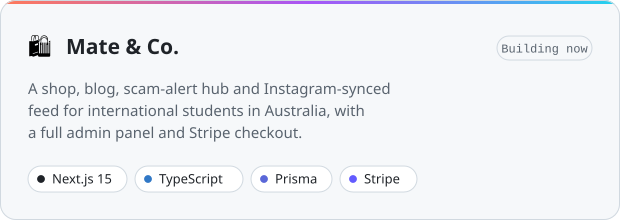

<picture>
  <source media="(prefers-color-scheme: dark)" srcset="assets/banner-dark.svg">
  
</picture>

 

### G'day, I'm Yohjit 👋

I'm a **Data & AI Engineer** in Melbourne. I build the pipelines, cloud plumbing and AI workflows that turn messy raw data into insights people can act on.

- 💼 **Now:** Data & AI Engineer at **LivedCX**, turning call-centre voice recordings, metadata and logs into process-mining insights with Azure AI Foundry and LLMs.
- ☁️ **Proudest win:** redesigned our data architecture from virtual machines to Data Factory, Databricks, Functions and Container Apps. It's faster, and monthly infrastructure costs dropped by about 25%.
- 🐾 **Open source:** led the HMI team on [**Project Echo**](https://github.com/DataBytes-Organisation/Project-Echo), the bioacoustics project that won a 2023 National iAward.
- 🎓 **Studied:** Bachelor of Software Engineering (Honours), majoring in AI, at Deakin University.
- 🛠️ **On the side:** an algorithmic trading engine, and **Mate & Co.**, a shop for international students.

 

<picture>
  <source media="(prefers-color-scheme: dark)" srcset="assets/highlights-dark.svg">
  
</picture>

 

<picture>
  <source media="(prefers-color-scheme: dark)" srcset="assets/experience-dark.svg">
  
</picture>

 

<picture>
  <source media="(prefers-color-scheme: dark)" srcset="assets/toolbox-dark.svg">
  
</picture>

 

<picture>
  <source media="(prefers-color-scheme: dark)" srcset="assets/codex-dark.svg?v=64fdb82f9855b0dc">
  
</picture>

 

### Things I've built

  <a href="https://github.com/DataBytes-Organisation/Project-Echo"><picture><source media="(prefers-color-scheme: dark)" srcset="assets/card-project-echo-dark.svg"></picture></a>
  <picture><source media="(prefers-color-scheme: dark)" srcset="assets/card-stonks-dark.svg"></picture>

  <a href="https://github.com/xOscarCodes/SEES-Smart-Eatery-and-Evacuation-System"><picture><source media="(prefers-color-scheme: dark)" srcset="assets/card-sees-dark.svg"></picture></a>
  <a href="https://github.com/xOscarCodes/ServerCool"><picture><source media="(prefers-color-scheme: dark)" srcset="assets/card-server-cool-dark.svg"></picture></a>

  <picture><source media="(prefers-color-scheme: dark)" srcset="assets/card-fire-detection-dark.svg"></picture>
  <picture><source media="(prefers-color-scheme: dark)" srcset="assets/card-mate-and-co-dark.svg"></picture>

### Research

📄 **IoT-Enabled Smart Restaurant Management System.** Singh, C., **Chopra, Y.**, Gupta, I., Singh, H., Kumar, A. and Dias, I. *International Conference on Deep Learning, Artificial Intelligence and Robotics*, Springer Nature Switzerland, 2023, pp. 395–404.

 

Melbourne, Australia 🇦🇺 · Always happy to talk data pipelines, generative AI, or anything IoT.

